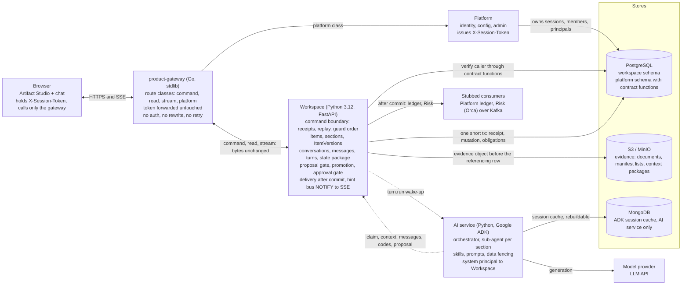
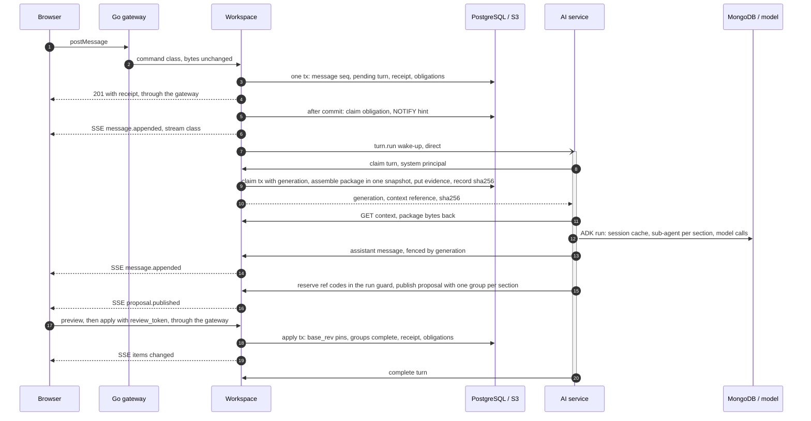

# Product System Architecture

Phase 1 MVP, decisions through 2026-10-30.
Written for the Workspace, Platform and AI teams.

Every component, who talks to whom, and the rule each boundary enforces.
The Go gateway is transport only.
Workspace is the only writer of product state.
Platform owns identity.
The AI service owns instructions and never writes Workspace tables.

## Components and boundaries

Figure 1.
Components and the boundaries between them.
The browser reaches only the Go gateway.
The gateway forwards to Workspace and Platform without touching bodies or tokens.
Workspace and the AI service talk directly (dashed arrows never pass through the gateway).
Platform's identity facts live in the shared PostgreSQL and Workspace reads them through contract functions.
MongoDB is the AI service's rebuildable cache.
The ledger and Risk consumers are stubs in the MVP.

| Component | Owner | Stack | Owns | Never does |
| --- | --- | --- | --- | --- |
| Browser | UX team | Artifact Studio UI with the chat thread | The session token in a header, the event-stream subscription, reconciliation of hints against reads | Call Workspace, Platform or the AI service directly |
| product-gateway | Workspace team, own repo | Go, standard library only | Routing by path prefix, route classes with timeouts and body limits, rate limits, CORS, TLS, request ids, metrics, readiness | Authenticate, rewrite a body, retry, hold state, orchestrate |
| Workspace | Workspace team | Python 3.12, FastAPI, SQLAlchemy 2, Alembic | The command boundary, items and immutable versions, conversations, turns, the state package, the proposal gate, promotion, the approval gate, delivery of obligations, the event stream | Let anything but a receipted command change product state |
| Platform | Platform team | Shares the PostgreSQL instance | Users, sessions, memberships, system principals, administration, configuration, the ledger | Write Workspace tables |
| AI service | AI team | Python, Google ADK, MongoDB for its session cache | The orchestrator, section sub-agents, skills and prompts, fencing of untrusted data, provider evidence | Write Workspace tables, keep the only copy of anything receipted |

## One turn, end to end

This is the flow the three teams argued about, with every hop placed.
The AI service holds a generation-fenced claim on the turn from the claim to the completion.
The context it works from is assembled at claim time and stored as evidence before the AI service reads it.

Figure 2.
One turn, end to end.
Browser hops pass through the gateway unchanged.
The AI service talks to Workspace directly as a system principal and holds the claim from step 8 to step 20.
The context package is assembled at claim time, from one snapshot, and stored as evidence before the AI service reads it.

1. **postMessage.** The browser posts to the conversation through the gateway's command class (30 s, 256 KiB).
2. **Forward.** The gateway forwards the request with the token header untouched.
3. **One short transaction.** Workspace resolves the session through Platform's contract function, locks the conversation row, appends the message with the next `seq`, opens a pending turn if none is running, and commits the receipt and the named obligations (`hint.message.appended`, `turn.run`) together.
4. **Response.** The 201 and its receipt return byte for byte through the gateway.
   A retry with the same `operation_id` replays the receipt.
5. **After commit.** The deliverer claims each obligation record.
   The hint consumer marks it delivered and issues `NOTIFY` in the same transaction.
6. **Hint.** The event stream, held open through the gateway's stream class with no timeout, sends an identity-only hint.
   The browser refetches what changed.
7. **Wake-up.** The `turn.run` consumer calls the AI service directly.
   If the call is lost, the reconciler re-drives it; the AI service can also poll for pending turns.
8. **Claim.** The AI service claims the turn as a system principal.
   The claim carries a generation; a stale generation can no longer write.
9. **Context assembly.** Inside the claim, Workspace assembles the state package from one snapshot (stage, sections, current item versions and revisions, interview status, the full transcript), writes the canonical rendering to S3, and records key, version id and sha256 on the turn.
10. **Claim response.** Generation, context reference and hash.
11. **Context read.** The AI service reads the package under its live claim.
    This is also the cache-rebuild path.
12. **Agent run.** The AI service merges the package into its ADK session (MongoDB), fans out one sub-agent per section against the model, fans in, and validates the candidate.
13. **Assistant message.** Posted through Workspace, fenced by the generation, receipted like any write.
14. **Hint.** Same path as step 6.
15. **Reservation and publication.** Ref codes are reserved inside Workspace's run guard.
    The proposal is published with one group per section, pinned to the package's revisions.
16. **Hint.** The browser shows the cards.
17. **Preview and apply.** A card decision is the proposal gate.
    Preview issues a short-lived `review_token`; apply checks groups, dependencies and `base_rev` pins, and answers with the closed 409 set when anything moved.
18. **Apply transaction.** New item versions, receipt and obligations in one transaction.
    The original `applied_by` is never replaced.
19. **Hint.** The browser refetches the tree.
20. **Complete.** The turn closes; the next pending message opens the next turn.

> **What the MongoDB session is, and is not.**
> It is the AI service's cache of the model-facing event log, one session per Workspace conversation.
> Losing it loses nothing the product promises: the next claim rebuilds it from the state package.
> Nothing receipted, gating or evidential lives there.
> The UI never reads it.

## Boundary rules

| Boundary | Rule | Where it is specified |
| --- | --- | --- |
| Browser to gateway | The gateway is the only reachable origin. The token travels in `X-Session-Token`. Hints carry identities only; the client reconciles against reads. | init-gateway specs, add-conversations event-stream spec, design doc s16 |
| Gateway to backends | Route by longest path prefix. Pass bodies, headers and status through byte for byte. Never retry. Gateway-originated errors carry a fixed JSON body and `X-Error-Origin: gateway`. | init-gateway request-routing, error-passthrough and admission-control specs |
| Workspace to Platform | Workspace never authenticates by itself and never reads Platform tables. It calls contract functions in the `platform` schema at the boundary and again inside the transaction. A lost session is 401; lost authority is 403 with the fixed body. | use-platform-identity, decision 0009, decision 0002 |
| Workspace to AI service | The AI service is a system principal and acts only through commands. Claims are fenced by generation. Context is pulled, never pushed. Proposals pin the revisions they were generated from, and a changed target blocks apply. | add-state-package, add-turns (next), design doc s10 and B15 |
| Workspace to its stores | Receipt, mutation and obligations commit in one short transaction. Immutable tables reject updates and deletes at the database role level. An evidence object is written before the row that references it. | CLAUDE.md invariants, decision 0001, immutable-records spec |
| AI service to MongoDB | A cache keyed by conversation id, rebuildable from the state package. No transaction spans it, so it needs no replica set. | Agreed 2026-10-30 |

## Gateway route classes

| Class | Routes | Upstream timeout | Body limit | Flush |
| --- | --- | --- | --- | --- |
| command | POST on /projects, /conversations, /artifacts, /items, /turns, /assessments | 30 s | 256 KiB | default |
| read | GET on the same prefixes | 10 s | none, body refused | default |
| stream | GET /projects/{id}/events | none | none, body refused | immediate, write deadline cleared |
| platform | /auth, /config, /admin | 30 s | 256 KiB | default |

Rate limits are per session token hash, with a separate anonymous bucket per client address, answered with 429 and `Retry-After` before the body is read.
Service-to-service traffic between Workspace and the AI service does not pass through the gateway.

## Stores

| Store | Used by | Holds | Rule |
| --- | --- | --- | --- |
| PostgreSQL, workspace schema | Workspace | Project spine, stage instances, artifacts and counters, items and immutable versions, sections, receipts, conversations, messages, turns, obligations and delivery claims, approvals | Insert-only role plus triggers on immutable tables. Row locks in the documented guard order. Snapshot reads at REPEATABLE READ. |
| PostgreSQL, platform schema | Platform writes, Workspace reads through functions | Sessions, memberships, system principals | SECURITY DEFINER functions are the contract. Workspace holds a session or membership row FOR SHARE inside a write. |
| S3 / MinIO | Workspace | Review and final documents, manifest member lists, context packages, assessment payloads and responses | One key per object. Versioned bucket, Object Lock on evidence. Key, version id and sha256 on the referencing row. |
| MongoDB | AI service | ADK session events per conversation | Cache only. Rebuildable. Never in a Workspace transaction. |
| Kafka | Workspace delivery, stubbed | Assessment requests and results for Risk | Request persisted before publication; result committed with its receipt before the offset advances. |

## Where the work stands

| Change | Repo | Stream | Status on 2026-10-30 |
| --- | --- | --- | --- |
| init-workspace-core | Workspace | 1 Workspace core | implemented, 49/49 tasks, not archived |
| add-item-section-writes | Workspace | 1 Workspace core | proposed |
| use-platform-identity | Workspace | 1 Workspace core | proposed |
| add-conversations | Workspace | 7 Conversations | proposed |
| add-state-package | Workspace | 7 Conversations | proposed |
| add-turns | Workspace | 7 Conversations | next to propose |
| init-gateway | product-gateway | Gateway | proposed |
| add-proposal-apply-gate | Workspace | 2 Proposals | planned |
| add-stage-promotion | Workspace | 3 Promotion | planned |
| add-approval-gate | Workspace | 4 Approval | planned |
| add-risk-and-ledger-delivery | Workspace | 5 Delivery | planned |
| add-adk-generation | Workspace and AI service | 6 Generation | planned, after stream 2 is archived |

## Local topology

- The browser talks to the gateway on `:8080`.
  The gateway's internal listener for metrics and health is `127.0.0.1:9090`.
- The gateway forwards Workspace routes to `http://127.0.0.1:8000` and Platform routes to Platform's base URL when configured.
- PostgreSQL runs from docker-compose on host port `5442`, with the `product_owner`, application and insert-only roles created by the init script.
  MinIO joins the same compose file with the approval gate.
- The AI service and Platform run on ports the teams agree.
  The AI service reaches Workspace directly, never through the gateway.

Three cross-team items are open:

- Platform confirms the `X-Session-Token` header name and the contract function names (decision 0009).
- Workspace adds `GET /healthz` for the gateway's readiness probe.
- The AI team confirms the claim and context endpoints when add-turns is proposed.
